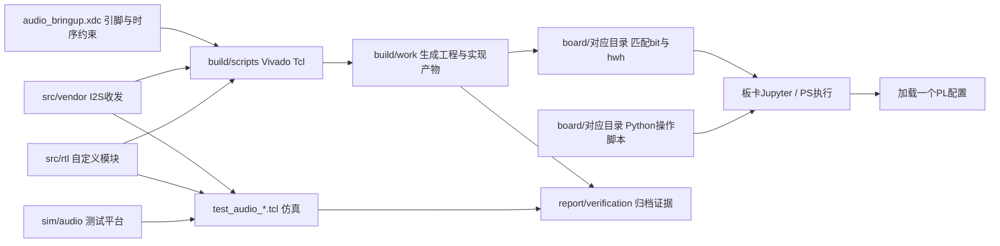
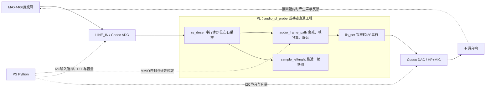
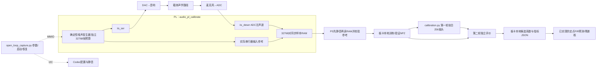
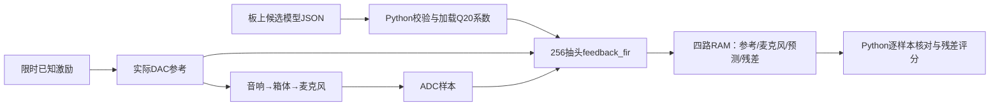

# 工作区结构与系统流程

> **以下系统图是 2026-10-19 的历史架构快照，保留用于理解早期诊断链路。** 其文件树未覆盖后来的 audio_replay/v3，不能据此认定闭环仍未实现。
> 阅读主链路请转 [核心代码阅读顺序](code-reading-guide.md)，部署请转 [上板版本索引](../../board/README.md)。

核对日期：2026-10-19。基础直通、开环标定和256抽头PL残差链路均已有实物证据；最新开环预测误差降低6.92 dB、逐样本一致。闭环稳定增益仍未验证。动态状态见 [STATE](../STATE.md)；日志只用于追溯。

## 1. 先看工作区分层

```text
Flushbonading_FPGA_Contest/
├─ README.md                  总入口、当前状态
├─ AGENTS.md                  AI开始任务、验证及交接规则
├─ .gitignore                 缓存、构建输出、临时文件的忽略规则
├─ src/                       可编辑的实现源码
│  ├─ rtl/                    自定义Verilog模块
│  ├─ vendor/pynq_v2_4/        厂商I2S收发VHDL、来源和许可证
│  └─ feedback/               Python路径辨识与定点参考
├─ sim/                       RTL测试平台与Python用例
│  ├─ audio/                  tb_audio_*.v
│  └─ feedback/               test_calibration.py、test_capture_driver.py
├─ build/
│  ├─ scripts/                Vivado工程、仿真、实现和约束脚本
│  └─ work/                   本机生成工程、IP、运行目录；Git忽略
├─ board/                     按独立overlay分组的上板包
│  ├─ audio_bringup/          最小音频工程
│  ├─ audio_probe/            电平快照和限时直通
│  ├─ audio_diag/             静音数字发送诊断
│  ├─ audio_tone/             已知短音调诊断
│  ├─ audio_capture/          连续ADC采样诊断
│  ├─ audio_calibrate/        已知激励与同步参考/麦克风标定
│  └─ audio_residual/         四路开环残差验证与手动Notebook
├─ scripts/                   电脑侧分析命令行入口、定位仓库辅助脚本
├─ docs/                      当前方案、接口、实验操作、交接和历史方案
├─ report/                    验证证据和AI协作记录
├─ data/                      数据归档约定；真实标定NPZ尚未存入此处
├─ references/                板卡手册、原理图和赛事指南
├─ skill/                     可复用协作与排查经验
├─ tmp/                       本地临时分析、副本和测试数据；Git忽略
├─ .Xil/                      Vivado本机工作缓存；Git忽略
└─ NA/                        现有ps7_summary.html，归属待核对，非源码入口
```

`.git/`保存版本历史。本次同步包含源码、上板包和文档；原始板上数据与候选模型仍不在仓库，实物指标不能仅靠克隆复现。不要依据文件夹存在就认定功能完成，也不要直接清空不认识的目录。

## 2. 从源码到板上程序



`.bit`是FPGA配置，`.hwh`描述IP与地址，Python利用HWH找到MMIO寄存器。三者必须属于同一工程；不能把probe的脚本、capture的HWH和calibrate的bit混用。生成文件进入board是发布整理步骤，图中的箭头不表示所有脚本都会自动复制文件。

`create_audio_calibrate.tcl`实际创建Zynq PS7、AXI GPIO、音频RTL、时钟及复位连接；PS通过AXI GP0访问GPIO，通过I2C1配置Codec。当前工程面向Vivado2018.3及PYNQ-Z2。报告中的正时序裕量不等于完整板级签核，外部音频I/O延迟约束仍有缺口。

## 3. 当前实时直通链路



音频逐帧处理在PL中完成，Python不在每个采样的实时处理循环里。`valid`表示采样对有效；24位数据为补码。`audio_frame_path`只有右移衰减和限时保护，没有反馈预测或抵消。基础通路获用户纯音、人声可听验证，尚未量化完整音质和延迟。

`sample_left/right`是快照，PS轮询不能将其当成连续等间隔录音。需连续样本时使用专门的RAM捕获工程。各种overlay替换同一块PL配置，不是六个同时运行的音频阶段；换配置后旧MMIO对象应丢弃并重新初始化。

## 4. 当前开环标定及模型流程



此模式ADC只进入RAM，不回送DAC；虽然存在音响到麦克风的声学路径，但没有完整扩声闭环。训练和验证使用不同噪声种子、相同箱体与增益。每轮发声标称约0.671秒，慢速PS读回发生在Codec静音之后。

模型为 `mic[n] ≈ bias + Σ h[k] × reference[n−1−k]`。h[0]乘前一帧参考；bias用于离线评分，不能不加分析地当实时反馈直接相减。标定源码中`capture_left`实际为DAC参考，`capture_right`实际为ADC左声道，不能按名字解释成录音左右声道。

原始NPZ、`candidate_box_v1_256.json`、`analysis_box_v1_256.json`及`Untitled.ipynb`在板卡 `/home/xilinx/jupyter_notebooks/base/audio/audio_calibrate/`，未备份进本地data目录。电脑侧有同一算法的源码和合成数据入口；本次真实数据拟合是在板卡PS上执行的，不是FPGA计算。

## 5. 核心文件职责

### src：实现与第三方依赖

| 文件 | 职责及主要耦合 |
|---|---|
| rtl/audio_frame_path.v | 公用限时直通处理；被bringup/probe/diag/tone使用 |
| rtl/audio_pl_bringup.v | 最小I2S收发与帧通路顶层 |
| rtl/audio_pl_probe.v | 直通顶层加最近ADC帧快照 |
| rtl/audio_pl_diag.v | 加发送非零帧/串行1计数；诊断模式可强制外部数据脚为0 |
| rtl/audio_pl_tone.v | 加已知三段方波音调，用于隔离输出问题 |
| rtl/audio_pl_capture.v | 包装probe，按帧计数变化存4096帧左右ADC；静音采样由操作脚本保持控制字实现，不能假定任何控制配置都不发声 |
| rtl/audio_pl_calibrate.v | 独立激励、收发和32768对参考/ADC捕获；不通过audio_frame_path做回送 |
| vendor/pynq_v2_4/iis_ser.vhd | PYNQ v2.4厂商I2S发送器，24位采样串行化 |
| vendor/pynq_v2_4/iis_deser.vhd | 厂商I2S接收器，输出左右数据与VALID；来源说明保留时序TODO提醒 |
| vendor/pynq_v2_4/README.md、LICENSE | 来源版本及BSD许可；不删除第三方署名 |
| feedback/calibration.py | Capture校验、历史矩阵、岭回归拟合、独立评价、Q20量化、整数FIR参考、模型导出 |
| feedback/__init__.py | Python包入口；具体算法在calibration.py |

### board：可部署的独立工具包

每个audio_*目录有同名bit/hwh。以下Python文件是操作入口，不应盲目依次执行；实际使用前阅读对应接口和脚本。文件名含notebook的.py是Python片段/脚本，不代表已经导出板上.ipynb。

| 目录 | Python文件 | 用途 |
|---|---|---|
| audio_bringup | muted_smoke.py | 最小配置的静音检查 |
| audio_bringup | codec_clock_smoke.py | Codec时钟/PLL相关诊断 |
| audio_bringup | known_tone_notebook.py | 官方音频链已知测试音对照 |
| audio_probe | muted_adc_probe.py、level_probe_notebook.py | 静音ADC快照、电平对照 |
| audio_probe | bounded_passthrough_notebook.py、bounded_mic_trial.py | 限时直通；本地后者上限改至3秒，长窗口尚未完成上板验收 |
| audio_diag | muted_tx_diag.py | 内部数字发送活动诊断，外部输出保持静音 |
| audio_tone | bounded_tone.py | 自定义PL短音调测试，结束恢复 |
| audio_capture | muted_frame_capture.py | 连续ADC捕获及统计，区分快照与连续样本 |
| audio_calibrate | open_loop_capture.py | 现场确认后播放已知激励、读取成对样本、本地保存及恢复 |
| audio_calibrate | manifest.json、README.md | 历史构建文件校验值、现场步骤；注释版源码哈希变化见阅读指南 |

### build、sim、scripts：生成与验证

| 文件或文件组 | 用途 |
|---|---|
| build/scripts/create_audio_*.tcl | 创建相应独立Vivado工程；具体参数和是否自动构建以脚本为准 |
| synthesize_audio_*.tcl、implement_audio_*.tcl | 部分历史工程分开的综合、实现入口 |
| test_audio_*.tcl | 调用对应测试平台进行仿真 |
| audio_bringup.xdc | 共用板卡音频引脚/时序约束，仍有外部I/O时序缺口 |
| inspect_audio_timing.tcl、probe_audio_io_constraints.tcl | 时序及约束排查，不是音频算法 |
| sim/audio/tb_audio_frame_path.v、tb_audio_i2s.v | 基础处理和I2S行为测试 |
| sim/audio/tb_audio_probe*.v | probe及变化帧数据测试 |
| sim/audio/tb_audio_diag.v、tb_audio_tone.v | 静音数字诊断和已知音调测试 |
| sim/audio/tb_audio_capture.v、tb_audio_calibrate.v | 缩小捕获实例、同步数据及停止条件验证 |
| sim/feedback/test_calibration.py | 合成路径、非法数据及定点边界验证 |
| sim/feedback/test_capture_driver.py | 模拟硬件的采集脚本测试，不证明真实I2C时序 |
| scripts/make_synthetic_calibration.py | 生成合成训练/验证数据供电脑离线复现 |
| scripts/fit_feedback_path.py | 命令行加载两份NPZ、训练/评价并导出模型 |
| scripts/enter-repo.sh | Git Bash快速定位工作区，与音频算法无关 |

### docs、report、其他目录：如何查资料

`docs/contracts/` 解释格式、寄存器、时序和版本，是跨模块协作依据；`docs/log/experiments/` 保存操作规程与排障过程；`docs/ref/` 收长期参考（架构、计划、教程、硬件）；`docs/templates/` 提供任务、接口、AI 记录模板；`docs/archive/` 保留早期 AI 方案与失效任务，不能当当前工程规格。目录分层的理由见 [workflow](../WORKFLOW.md)。

`docs/development-plan.md`给出路线，`procurement-review.md`是采购讨论；当前完成状态看`progress.md`，接手看`handoff-2026-10-17.md`，读源码看`core-code-reading-guide.md`，Git操作看`repository-guide.md`。

`report/verification/`保存工具输出、分析摘要和校验记录；`report/ai-records/`记录采用的方案、纠错与证据边界，摘要不冒充原始聊天。入口为 [evidence-index.md](../../report/evidence-index.md)。

`references/hardware/`保存板卡手册/原理图，`references/competition/`保存AMD赛事指南。`skill/`是经验文档。`data/README.md`是归档约定，不证明真实录音已经备份。`__pycache__/`是Python缓存。`NA/ps7_summary.html`属于现有PS7摘要文件，来源未进一步确认，本次不移动删除。

## 6. 接手时优先检查的耦合点

| 耦合点 | 必须一起核对 |
|---|---|
| 工程版本 | bit、hwh、Python寄存器字段与源码版本；当前原manifest仍是旧构建快照 |
| 数据时间 | 自定义标称48828.125 Hz、同帧配对、h[0]对应前一帧；不要任意移位对齐 |
| 物理条件 | fixture_id、箱体位置、模拟增益、Codec音量；改条件后重新评价模型 |
| 数值格式 | 24位PCM/2^23，24位系数/2^20；舍入和饱和必须与参考一致 |
| 生命周期 | 一次一名操作者；配置切换后重建对象；结束静音并核对base/PLL恢复 |
| 验收 | 软件预测、RTL仿真、上板残差、闭环ASG分别记录，不能互相替代 |

当前FIR使用实际DAC历史参考，并从麦克风样本中减去预测值；接口见audio-residual-v1。残差只存RAM，不送DAC。闭环中的增益、保护、时序及自适应更新仍需单独设计验证。

## 7. 当前开环残差链路



残差与DAC没有连接，故此图不能代表闭环抑制。现场入口为board/audio_residual/residual_trial.ipynb；一次仅手动运行指定单元。
